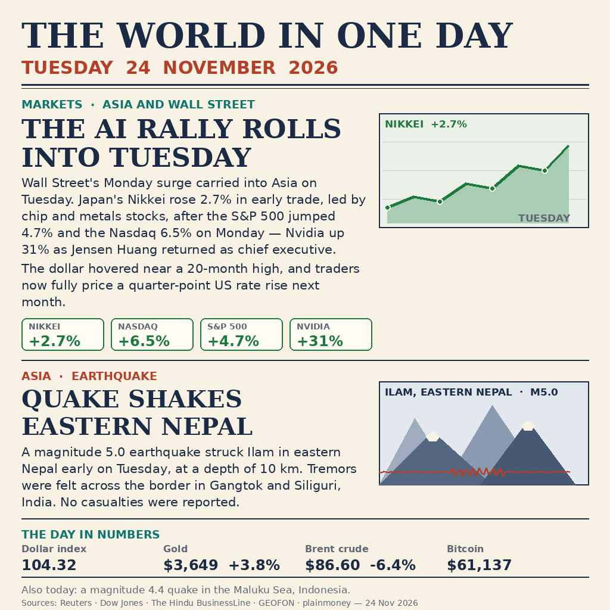

# The World in One Day — Tuesday 24 November 2026

A single front-page poster that sums up Tuesday 24 November 2026's world news in one image — an entry for the [make.fun bounty "Sum up 24 November's world news in one image"](https://make.fun/bounty/news-image-20261124).

## What's on the poster

**Top story — the AI rally rolls into Tuesday.** Wall Street's Monday surge carried into Asia: Japan's Nikkei rose 2.7% in early trade, led by chip and metals stocks, after the S&P 500 jumped 4.7% and the Nasdaq 6.5% on Monday — Nvidia up 31% as Jensen Huang returned as chief executive. The dollar hovered near a 20-month high, and traders now fully price a quarter-point US rate rise next month. Sources: Reuters, Dow Jones, The Hindu BusinessLine (24 November 2026).

**Second story — quake shakes eastern Nepal.** A magnitude 5.0 earthquake struck Ilam in eastern Nepal early on Tuesday, at a depth of 10 km. Tremors were felt across the border in Gangtok and Siliguri, India. No casualties were reported. Sources: GEOFON, EarthquakeLive (24 November 2026).

**The day in numbers:** dollar index 104.32; gold $3,649, up 3.8%; Brent crude $86.60, down 6.4%; Bitcoin $61,137. Sources: Reuters, plainmoney (24 November 2026).

**Also today (footer):** a magnitude 4.4 quake in the Maluku Sea, Indonesia, early on Tuesday (VolcanoDiscovery, 24 November 2026).

## Research notes

Tuesday 24 November 2026 was barely under way in the West when this poster was drawn (early morning UTC), so the day's verified stories come from Asia's Tuesday session and overnight wires. Several big overnight stories were checked and deliberately left out because they happened on Monday 23 November, not Tuesday: the COP31 collapse (22–23 Nov), FIFA naming the 2031/2035 Women's World Cup hosts, the TRIPP corridor launch in Armenia, the flogging of singer Parastoo Ahmadi in Iran, the US Treasury's Iran shadow-banking sanctions, the EU's 22nd sanctions package, the UN chief's AI safety call, and the Medvedev nuclear-warning article (published Monday in the Moscow Journal of International Law).

## How it works

- `poster.py` — a Python program that draws the whole poster with Pillow (warm paper background, navy ink, teal/rust/green accents). Every illustration is drawn in code — the rising market chart, the Himalayan ridges with a seismograph trace — and all text is word-wrapped to fit its box. Run `python3 poster.py` to regenerate `entry.png` (1024×1024).
- `main.ts` — the Node entry point. It copies `entry.png` into the directory from the `MAKEFUN_OUTPUT_DIR` environment variable (default `/output`), creating the directory if needed. It uses only the Node standard library and no network, so running it twice gives byte-identical output.
- `entry.png` — the finished poster, 1024×1024.

## License

MIT — see [LICENSE](LICENSE).

New to make.fun? I got started through this link, and it supports my entries at no cost to you: https://make.fun/r/vy8jjegg
